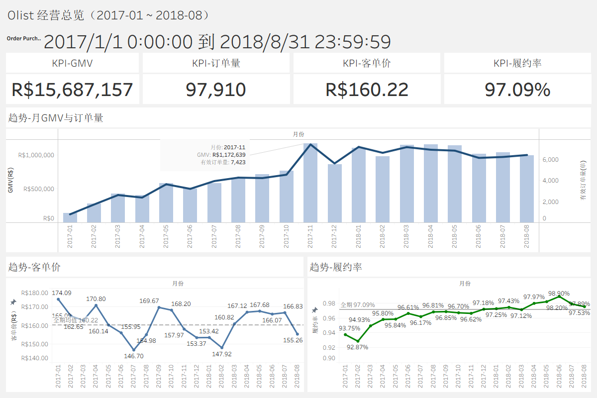
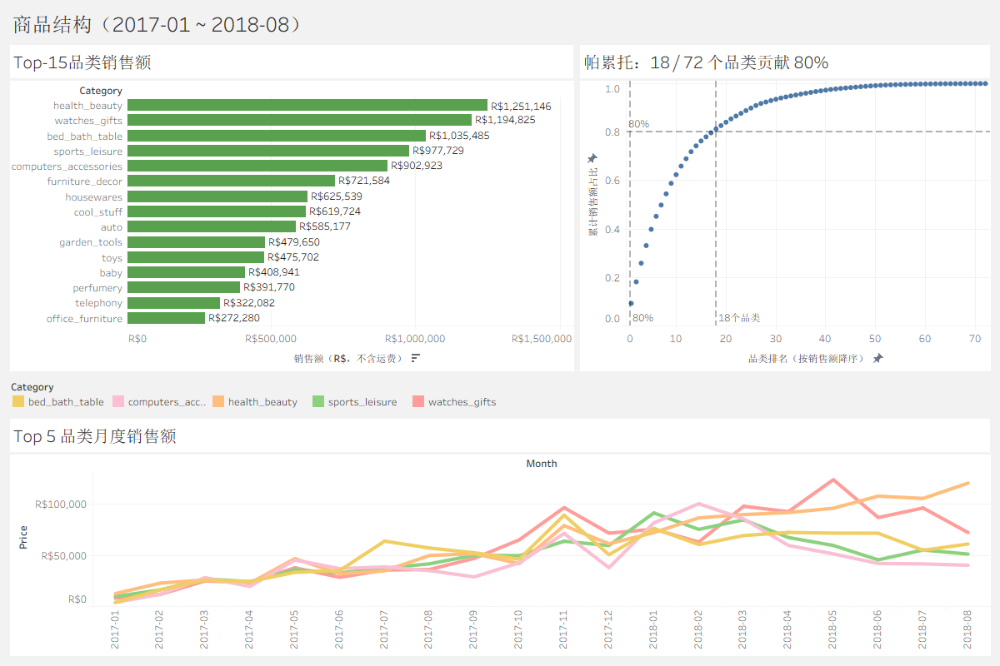
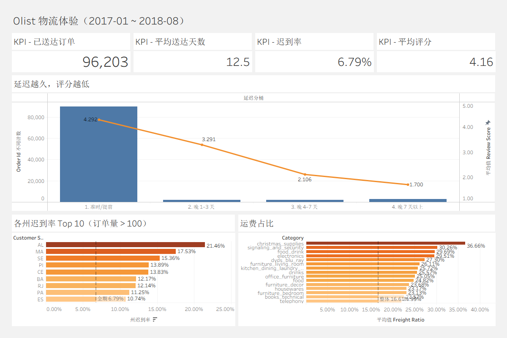
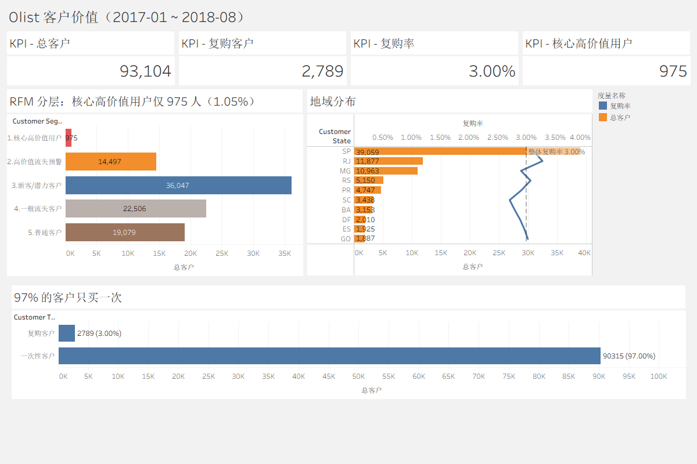

# Olist 巴西电商经营分析

> 基于 Olist 公开电商数据，用 **MySQL + SQL + Python + Tableau** 完成一次端到端经营分析：
> 从数据质量、增长趋势、商品结构，到物流体验与客户留存，并沉淀统一口径与结构化分析流程。

---

## 1. 项目背景

Olist 是巴西的一个电商平台。本项目站在**平台经营方**视角，回答四个问题：

1. 平台整体增长质量如何？GMV、订单量、客单价怎么变？
2. 收入集中在哪些品类？是否存在过度依赖？
3. 物流体验如何影响用户评分？问题主要出在哪一段？
4. 客户留存怎么样？哪些客户值得重点运营？

> 说明：这是一个**分析作品集项目**，数据来自 Kaggle 公开数据集，结论用于展示分析方法，不构成商业决策建议。

---

## 2. 数据概览

- **来源**：[Brazilian E-Commerce Public Dataset by Olist](https://www.kaggle.com/datasets/olistbr/brazilian-ecommerce)（公开数据集）
- **规模**：9 张表，约 99,441 个订单
- **时间范围**：2016-09 ~ 2018-10
- **分析窗口**：**2017-01-01 ~ 2018-08-31**（剔除 2016 启动期和 2018 年末不完整数据）

| 表 | 行数 | 说明 |
|---|---:|---|
| orders | 99,441 | 订单主表 |
| customers | 99,441 | 客户（订单级） |
| order_items | 112,650 | 订单明细 |
| order_payments | 103,886 | 支付 |
| order_reviews | 99,223 | 评价 |
| products | 32,951 | 商品 |
| sellers | 3,095 | 卖家 |
| product_category_name_translation | 71 | 品类翻译 |
| geolocation | 1,000,163 | 地理位置（去重后 19,015 个邮编） |

---

## 3. 指标口径（重要）

> 同一个指标只能有一种口径。本项目统一如下，详细定义见 `analysis_code/`。

| 指标 | 口径定义 | 状态过滤 | 时间窗口 |
|---|---|---|---|
| GMV | 有效订单支付金额之和（**含运费**） | 排除 `canceled/unavailable` | 2017-01 ~ 2018-08 |
| 商品销售额 | 有效订单 `price` 之和（**不含运费**） | 排除 `canceled/unavailable` | 同上 |
| 订单量 | 有效订单去重数 | 排除 `canceled/unavailable` | 同上 |
| 客单价 AOV | GMV / 订单量 | 同上 | 同上 |
| 取消率 / 履约率 | canceled / delivered ÷ **全部订单** | 不过滤（分母全量） | 同上 |
| 迟到率 | late 订单 ÷ 已送达订单 | `delivered`，且送达/预计送达日期非空 | 同上 |
| 复购率 | 下单 ≥2 次客户 ÷ 总客户 | `delivered` | 同上 |
| RFM | R/F/M 三维打分（1–5） | `delivered` | 同上 |

**为什么取消率/履约率用全量订单、GMV 用有效订单？**
因为前者要看「多少订单失败」，分母必须是全部订单；后者看「实际成交规模」，要排除失败订单。这是有意设计，不是矛盾。

---

## 4. 技术栈与分析流程

```
data_raw/*.csv
      │  LOAD DATA
      ▼
   MySQL 8.0 (olist)
      │  analysis_code/*.sql（CTE / 窗口函数 / 视图）
      ▼
   SQL 结果集
      │
      ├──► Jupyter + pandas + matplotlib/seaborn  → 分析图表
      │
      └──► Tableau                               → 交互看板
```

- **数据库**：MySQL 8.0
- **分析**：SQL（CTE、窗口函数、视图 `v_order_base`）
- **Python**：pandas、matplotlib、seaborn、SQLAlchemy、PyMySQL
- **看板**：Tableau（`.twb` / `.twbx`）
- **环境**：Python 3.12（依赖见 `requirements.txt`）

---

## 5. 目录结构

```
1/
├── analysis_code/              # 核心 SQL 分析
│   ├── 01_data_quality.sql
│   ├── 02_base_view.sql        # 基础视图 v_order_base
│   ├── 03_economic_trends.sql
│   ├── 04_commodity_structure.sql
│   ├── 05_logistics_experience.sql
│   ├── 06_customer_value.sql
│   ├── 07_tableau_view.sql     # 看板专用视图
│   └── customers_RFM.sql       # RFM 宽表 tableau_customer_rfm
├── create_database/            # 建表 + 导入脚本
│   ├── Olist_table.sql
│   └── Olist_import.sql
├── notebooks/                  # Jupyter 分析（连 MySQL 出图）
│   ├── db.py                   # MySQL 连接 + SQL 执行工具
│   ├── 01_data_loading.ipynb   # 数据接入
│   ├── 02_data_quality.ipynb   # 数据质量
│   ├── 03_economic_trends.ipynb
│   ├── 04_commodity_structure.ipynb
│   ├── 05_logistics_experience.ipynb
│   └── 06_customer_value.ipynb
├── dashboard/                  # Tableau 看板
│   ├── Olist_经营分析看板.twb
│   └── Olist_经营分析看板.twbx
├── images/                     # 看板截图
└── README.md
```

> Notebook 从数据接入、质量检查到各分析模块依次编号，与 `analysis_code/` 中的 SQL 分析步骤对应；`02_base_view.sql` 只创建视图，`07_tableau_view.sql` 与 `customers_RFM.sql` 供看板使用。

---

## 6. Tableau 看板

工作簿：`dashboard/Olist_经营分析看板.twb`（打包版 `.twbx`），连接 MySQL `olist` 库，共 4 页。

### 6.1 经营总览

GMV / 订单量 / 客单价 / 履约率四张 KPI 卡，以及月度 GMV 与订单量、客单价、履约率趋势。



### 6.2 商品结构

Top15 品类销售额、帕累托（18 / 72 个品类贡献 80%）、Top5 品类月度趋势。



### 6.3 物流体验

延迟分桶与评分、各州迟到率 Top10、品类运费占比。



### 6.4 客户价值

复购率、RFM 分层、地域分布。



---

## 7. 核心发现

> 以下数字均来自 `notebooks/` 的实际执行结果（窗口 2017-01 ~ 2018-08）。

### 7.1 增长：规模快速扩张，但 2018 下半年见顶

- 有效 GMV **R$ 15,687,157**，有效订单 **97,910**，客单价 **R$ 160.22**
- 月 GMV 从 2017-01 的 **R$ 137,007** 增至 2018-08 的 **R$ 996,896**
- **2017-11 是明显峰值**（GMV R$ 1,172,639），次月回落 **26.5%**，与黑五促销高度吻合
- 客单价从 174 缓降到 155，说明增长主要由**订单量**驱动，而非单价

**黑五（2017-11-24）单日脉冲**

- 单日 GMV **R$ 178,450**、订单 **1,166**，是前三个周五均值（R$ 27,619 / 163 单）的 **6.5 倍 / 7.1 倍**
- 客单价 **R$ 153**，低于全期均值 160，符合「以折扣换订单量」的促销特征
- 黑五单日贡献 11 月 GMV 的 **15.2%**；11 月 GMV 环比 10 月 **+53.3%**
- 外部参照：Ebit 数据，2017 年巴西电商黑五（11/23–24）销售额 **R$ 21 亿**，同比 **+10.3%**，订单量 +14%，客单价 -3.1%

### 7.2 质量：履约稳定，取消率低

- 平均取消率 **0.59%**，平均履约率 **97.09%**
- 规模增长的同时履约没有恶化，是正向信号

### 7.3 结构：收入集中度较高

- 销售额 Top 品类：`health_beauty`（R$ 1.25M）、`watches_gifts`（R$ 1.19M）、`bed_bath_table`（R$ 1.04M）
- 72 个品类中，**18 个贡献 80% 销售额**（约 25% 品类撑起 80%，80/20 基本成立）

### 7.4 物流：迟到对体验的杀伤是单调且陡峭的

- 已送达 **96,203** 单，平均 **12.5 天**，迟到率 **6.79%**，平均评分 **4.16**

| 延迟分桶 | 订单数 | 平均评分 | 差评率 |
|---|---:|---:|---:|
| 准时 / 提前 | 89,672 | 4.29 | 9.19% |
| 晚 1–3 天 | 1,869 | 3.29 | 31.89% |
| 晚 4–7 天 | 1,802 | 2.11 | 65.54% |
| 晚 7 天以上 | 2,860 | 1.70 | 76.96% |

> 迟到 7 天以上，差评率接近 77%，是体验治理的重点。

### 7.5 客户：复购率极低

- 总客户 **93,104**，复购客户（≥2 次）**2,789**，复购率 **3.00%**
- 平台高度依赖拉新，留存是明显短板

### 7.6 数据质量

- 送达日期缺失率 **2.98%**（对应未送达/取消订单，物流分析需过滤）
- 评价内容缺失率 **58.7%**（但评分 `review_score` 仍有值，评分分析不受影响）
- 同一订单多条评价 **547** 条（视图已去重）
- 品类为空商品 **610** 个、无法翻译 **13** 个
- 时间逻辑异常：批准晚于承运 **1,358** 条
- `geolocation` **1,000,163 → 19,015** 邮编（用地图前必须去重）

---

## 8. 局限与注意事项

- **相关性 ≠ 因果**：「首单迟到 → 复购率低」是观察性结论，可能存在地区、订单复杂度等混杂因素，不能直接归因。
- **右删失**：分析窗口截止 2018-08，越晚下单的客户可观察的复购时间越短，复购率可能被低估。
- **评价样本偏差**：58.7% 的评价内容为空，文本分析需单独说明；本项目只用了评分。
- **1 行差异**：`order_reviews` 在 MySQL 中 99,223 行，原始 CSV 99,224 行。已定位缺失行：CSV 第 82,210 行（`review_id = 29a50943...`）；它前一条评论以反斜杠 `\` 结尾、紧邻闭合引号，MySQL `LOAD DATA` 默认把反斜杠当转义符，引号被吞后该行并入了上一行。重导时加 `ESCAPED BY ''` 即可修复。
- **性能**：`v_order_base` 是视图，每次查询都会重新聚合，05/06 需 76–90 秒；看板直连时响应较慢，后续建议物化或加索引。

---

## 9. 致谢

数据来源：Olist（Kaggle 公开数据集）。本项目仅用于学习与作品展示。
